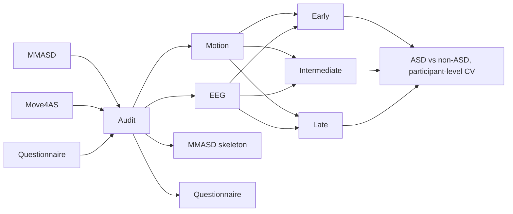

# Architecture

Diagram source: [`architecture.mmd`](architecture.mmd) (Mermaid). Red dashed nodes = branches that the
data do **not** support and that were therefore not implemented as results.

## Components

| Component | Module | Input | Output | Notes / adaptations |
|---|---|---|---|---|
| Safe extraction | `scripts/prepare_datasets.py` | raw zips in `Dataset/` | `Dataset/{Move4AS,MMASD,Questionnaire}/`, manifests | CRC test, path-traversal guard, idempotent, never touches originals |
| Move4AS download/verify | `scripts/download_move4as.py` | figshare API | `move4as_download_manifest.json` | size+MD5 vs API, Range resume, bounded retries, host allow-list |
| Move4AS preprocessing | `src/data/move4as.py`, `scripts/build_move4as.py` | `.mat` blocks | trial tensors/features, `alignment.csv` | per-recording filtering only (no cross-participant stats) |
| MMASD preprocessing | `src/data/mmasd.py`, `scripts/build_mmasd.py` | OpenPose JSON, ROMP npz | `X2d/X3d` (N,128,V,C) + masks | person tracking; same subject in 2D and 3D |
| Questionnaire | `src/data/questionnaire.py` | Toddler CSV | feature sets `items` / `no_items` | target = Q-CHAT sum > 3 (leakage documented) |
| **Model A — Skeleton MAE** | `src/models/mae.py` | (N,T,V,C) + valid mask | encoder checkpoints, embeddings, recon. metrics | temporal-patch tokens (4 frames × all joints), mask ratio 0.5, loss on masked & valid coords only. STH-MAE not used (no verified compatible implementation). |
| **Model B — PoseFormerV2 adapter** | `src/models/poseformer.py` | (N,T,V,C) | logits / embedding | spatial joint transformer + DCT low-frequency tokens + few time-domain tokens fused by a temporal transformer. Official model is a 17-joint H36M 2D→3D lifter; its checkpoints are incompatible, so this is a re-implementation of its ideas, **not** an exact reproduction. |
| **Model C — CTR-GCN** | `src/models/ctrgcn.py` | (N,T,V,C) | logits / embedding | official CTRGC, unit_gcn (3 subsets), multi-scale TCN kept; depth 10→4, width 64→32, dataset-specific graphs (Move4AS 21 rigid bodies, BODY_25, SMPL-24), M=1. |
| **Model D — EEG** | `src/models/eeg_cnn.py` + band-power LR | (N,14,500) @125 Hz / 140 band-power feats | P(ASD) | EEGNet-lite (~3 k params). Features: log & relative power δ θ α β γ × 14 channels (Welch). |
| **Model E — Questionnaire** | `scripts/run_questionnaire.py` | tabular | P(screen positive) | LogReg, LightGBM, MLP; fold-internal imputation/one-hot/scaling |
| Early fusion | `src/fusion/fusion.py::EarlyFusion` | motion feats (256) + EEG feats (140) | P(ASD) | per-modality standardisation on training fold, concat, L2-LR |
| Intermediate fusion | `IntermediateFusion` | skeleton tensor + EEG tensor | P(ASD) | CTR-GCN encoder + EEGNet-lite encoder → 32-d projections → concat → head, trained end-to-end |
| Late fusion | `LateFusion` | two modality probabilities | P(ASD) | weight w∈{0,…,1} minimising log-loss on training-fold inner predictions |
| CV | `src/training/cv.py`, `deep_cv.py` | groups, labels | folds | StratifiedGroupKFold by participant; inner participant split for thresholds/weights |
| Metrics | `src/evaluation/metrics.py` | y, P | all binary / multi-class / regression / reconstruction / efficiency metrics | unavailable metrics = `null` + reason |
| Report | `src/evaluation/report.py`, `plots.py` | OOF predictions | CSV/JSON metrics, plots | participant-level primary; trial-level secondary; participant-bootstrap CIs |

## Fusion is restricted to genuinely paired data
* Move4AS motion ↔ EEG: same participant, same recording block, same trial (verified by cue-sequence
  fingerprint, 147/155 blocks; 2,709 trials where both modalities pass QC).
* Questionnaire ↔ anything: **no shared participants** → no skeleton+questionnaire or three-modality fusion.
  Required for it: a questionnaire (e.g. AQ-10/SRS-2) administered to *all* Move4AS participants. The AQ
  in `Participants.xlsx` exists only for controls, so using it would encode the label.
* MMASD: no controls → no ASD-vs-non-ASD prediction, hence nothing to fuse with Move4AS.

## Positive-class convention
Label 1 = ASD (Move4AS `P*`; questionnaire "Yes" = screen positive). Probabilities are P(label = 1).
